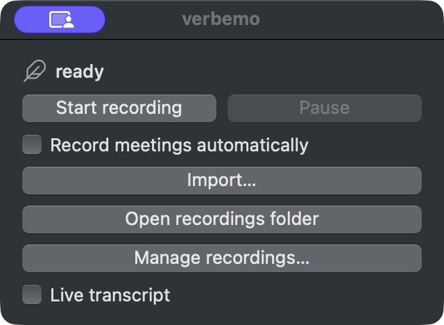

# Verbemo

Verbemo records meetings on your computer, transcribes them and writes summaries.
It is an independent continuation of Amanu. [Origin and licenses](docs/origin.md)
records the upstream history and copyright; development and support live in
[ekho/verbemo](https://github.com/ekho/verbemo).

[Download for macOS](https://github.com/ekho/verbemo/releases) ·
[Download for Windows](https://github.com/ekho/verbemo/releases) ·
[Support](https://github.com/ekho/verbemo/issues) · [MIT license](LICENSE)

<!-- public-download-versions:start -->
No Verbemo installer release has been verified here yet. Check Releases for availability.
<!-- public-download-versions:end -->

The root `VERSION` is the source version, not evidence of a published installer.
Both platforms share one source commit, one `Verbemo <VERSION>` release and one
`verbemo-v<VERSION>` tag. Public signed release preparation requires the project's
own credentials. Apple Developer Program enrollment is deferred; local ad-hoc
macOS development and testing remain available.

## What it does

- Records microphone and call audio, automatically or manually, without a meeting bot.
- Keeps audio, transcripts, speakers, summaries and processing logs in ordinary folders.
- Supports local Parakeet, Whisper and GigaAM transcription, a separate local live
  transcript, and optional cloud transcription through AssemblyAI, OpenAI or ElevenLabs.
- Uses Claude Code, Codex, Anthropic, OpenAI, OpenAI-compatible services or Ollama
  for summaries. Cloud services and subscription CLIs receive meeting data when selected.
- Supports optional calendar context on macOS; Windows has no calendar integration.
- Includes local speaker diarization on macOS. See [model evaluation](docs/testing/local-diarization-evaluation.md)
  for its limits; platform support is not proof of quality on your own meetings.

macOS requires 14.2 or later. The app builds for Apple Silicon and Intel;
local macOS transcription requires Apple Silicon. A universal build does not
establish physical Intel hardware acceptance. Windows requires Windows 11 24H2
or later on x64. See the [Windows build guide](windows/README.md).
Download local models before offline use. Ollama summaries stay local only when
its configured server is local. CLI subscriptions may need their own sign-in,
even when the corresponding desktop chat app is signed in.



[macOS EN/RU screenshots and acceptance evidence](docs/testing/verbemo-independent-releases-acceptance.md).

## Data and privacy

Recordings default to `~/Verbemo Recordings` (`%USERPROFILE%\Verbemo Recordings`
on Windows). macOS configuration lives in `~/.config/verbemo`; Windows data
lives in `%LOCALAPPDATA%\Verbemo Data`. Verbemo has its own model/cache paths.
It does not automatically migrate or modify Amanu's settings, recordings or
models. You can explicitly choose an existing recordings directory in Settings.
Shared provider credentials are read only; Verbemo writes its own keys locally.

The [CLI and configuration reference](docs/configuration.md) documents every
setting and provider key-file path, with platform differences and examples.
The optional [local MCP server](docs/mcp.md) exposes saved meetings and full audio
to authenticated local clients. Enable it and open connection instructions in General settings.

Application and website usage statistics are disabled. There is no analytics
backend, installation identifier or event upload. Old analytics fields cannot
enable reporting. Selected cloud processing, update checks and model downloads
still make their normal network requests. Read [Privacy](PRIVACY.md) and
[analytics behavior](docs/analytics.md) before choosing providers.

## Meeting files

A retained session folder contains `audio.m4a`, `transcript.md`, timed
`transcript.json`, `speakers.json`, `summary.md`, `meta.json` and processing logs.
Exact files depend on engine, retention and processing state. Failed
transcription keeps source audio for retry. Local diarization also retains the
lossless source and sidecars while its stage remains unfinished.
The recordings window shows completed, pending and failed work.

## Local macOS development

Use Xcode command line tools, Swift, Python 3, Node.js and CMake. Build from this
shared source tree:

```sh
make app SIGN_ID=-
swift test --no-parallel
python3 -m unittest discover -s Tests/scripts -p 'test_*.py'
python3 landing/tests/check.py
```

The local bundle is `.build/Verbemo.app`, with executable
`.build/Verbemo.app/Contents/MacOS/Verbemo`. `make app SIGN_ID=-` uses an ad-hoc
signature and does not notarize or publish. Launch the bundle through Finder
or Launch Services for permission testing; launching a binary from Terminal
can make macOS attribute permission requests to Terminal. Use `verbemo doctor`
for diagnostics; a bare SwiftPM invocation is not a packaged app acceptance test.
Quit the running app and confirm no recording is active before replacing a bundle.

The macOS CLI includes `verbemo setup`, `verbemo doctor`, `verbemo sessions`
and `verbemo process`. Run `verbemo --help` for the actual command options.
Windows has no equivalent public CLI. See the configuration reference above for
command examples, model selection, provider routing and hooks.

## Updates and distribution

macOS Sparkle uses the appcast in the project's own GitHub release. Installed
Windows copies download stable-channel updates while idle, then install the
pending package at the next normal **primary** startup, before recording or
processing starts. A second launch cannot install or terminate the running app.
There is no updater Restart now action. Quit normally after work and start the
app again. Portable copies do not self-update.

[The release runbook](docs/releasing.md) covers signed credentials, the common
release CLI, dry runs and recovery. [Package preparation](windows/packaging/README.md)
requires real release artifacts; no Verbemo Scoop/WinGet catalog publication or
install command is claimed. The [static site](landing/README.md) runs locally
without nginx, SSH or an analytics server. The current macOS screenshots show
the verified local development build; imported app screenshots remain inactive.
Windows screenshots and actual platform acceptance are deferred.
