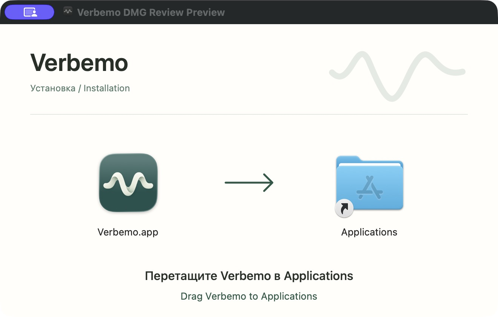
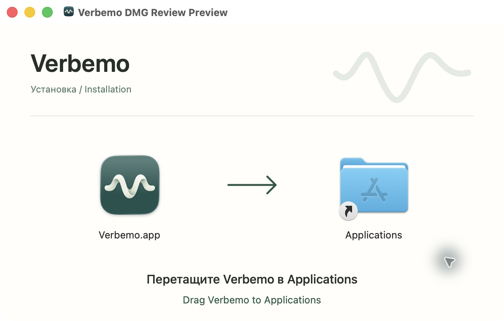

# Issue #48 — macOS DMG acceptance

## Local evidence

- 105 release-script tests passed. Fixture repositories used process-scoped
  `commit.gpgsign=false` because the sandbox cannot access the user's GPG agent;
  no user Git configuration was changed.
- 16 macOS packaging tests passed, including four new DMG tests. A real temporary
  image is built/mounted with spaces, an apostrophe and Unicode in its paths.
  Checks cover the Applications symlink, volume icon, saved positions/background
  alias, both TIFF representations (660×420 and 1320×840 at 660×420 logical size),
  executable permissions, bundle symlinks and the signature after copying out.
- Existing-output rejection and missing-app failure were tested. The product
  independence guard and shell syntax checks passed.
- Independent review found a final-flush failure could leave a partial image.
  A regression test with a 65,536-byte file-size limit reproduced it before the
  fix and passed afterwards. Cleanup now covers closing the file and preserves
  an existing destination it did not create.
- A packaging-only image of the installed Verbemo **0.15.1** was created with
  this branch's builder. This reused the app only as packaging input; it was not
  rebuilt, launched or replaced. Exact PR-source app builds are delegated to CI.
- On macOS 26.7.1, the image was opened in Finder on a Retina display in both dark
  and light appearance. App/folder placement, arrow, bilingual text, volume icon,
  hidden resources and readable labels were checked. The image was ejected and
  reopened; the layout persisted. The original dark appearance was restored.
- The real app was copied from the mounted image into an isolated temporary
  directory. `codesign --verify --deep --strict` passed, and its CodeResources
  seal matched the installed source app.

## Limits and implementation findings

Finder extension hiding adds FinderInfo to the signed bundle and fails strict
signature verification. The builder deliberately leaves that metadata alone;
Finder may display `Verbemo.app` depending on the user's preferences.

The shared builder verifies the app inside the finished image because dmgbuild
does not check its internal ditto exit status. Source app signatures are checked
before packaging; signed release processing still happens after layout.

Actual Developer ID signing, notarization, application launch, recording,
Windows GUI and older macOS releases were not tested as part of this packaging
change. No stable publication or installed-app update is implied.
