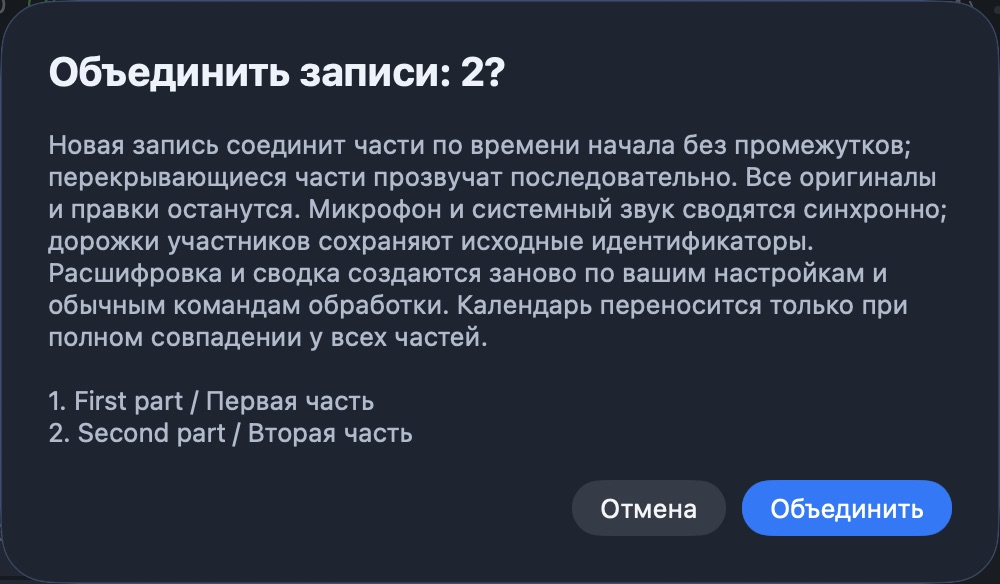
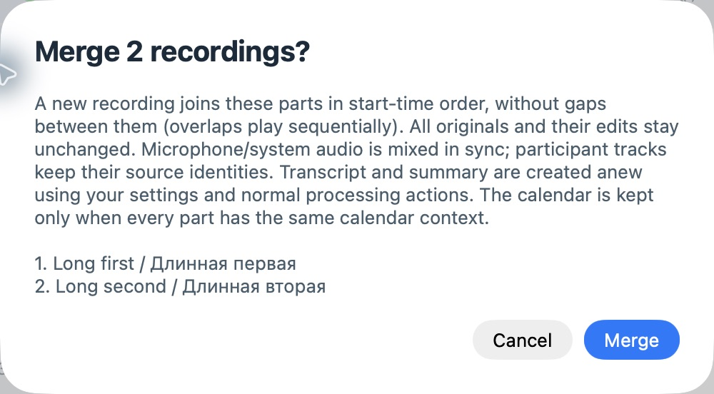

# macOS recording operations: #106 and #107

Base: `f2bc768` (0.24.1), after calendar-context PR #131 merged.
Host: macOS 26.7.1, Swift 6.4.2; minimum deployment target remains macOS 14.2.

## Selection and deletion

The native table supports Command/Shift selection and Select All. Refreshes retain
selected folder identities that remain visible. Right-clicking within the selection
keeps the group; clicking outside it selects that recording. Shift-F10 opens the
same menu. Command-Delete opens one confirmation containing the captured selection.
Search, filtering and inventory updates cannot change the confirmed identities.

Deletion rechecks recording markers, claims and processing work for each item.
Available items use the existing delayed macOS Trash route; busy or failed items
remain. The notice reports completed, pending and failed counts, with failure
details in its tooltip/accessibility help. Undo cancels the whole pending group;
already completed Trash moves remain recoverable through Finder.

## Merge semantics and safety

Two or more recordings create a new session, ordered by start time and then folder
path. Parts are concatenated without the wall-clock gap between sessions;
overlapping sessions play sequentially. Track offsets and pauses within each part
are retained. CAF, archived M4A and imported `source` audio use the existing audio
reader; ordinary microphone/system tracks are mixed synchronously to mono AAC.
Shared stereo archives are decoded once, including both channels.
The existing whole-second `duration_seconds` field remains an integer; per-part
provenance and audio retain millisecond precision, including on a subsequent merge.

Direct participant tracks stay separate, with source/participant IDs retained and
speaker/file keys namespaced by part. Names identify the part; equal display names
do not imply equal speakers. Original call metadata, files, channel mappings and
offsets are recorded in per-part `merge` provenance. The final direct-only track
gets silent padding in the new session when necessary to preserve a trailing pause.
Playback normalizes simultaneous tracks without making sequential parts quieter.

Original folders, manual edits, summaries and transcript versions are untouched.
The new session has no copied transcript or summary. It enters the existing
transcription callback and normal settings/actions for fresh processing. A calendar
association is copied only when every part has the same nonempty calendar object;
conflicting or missing context is dropped.

All sources are claimed through publication. Validation rejects busy/active,
missing, unsafe or unsupported audio. Metadata is rechecked after confirmation.
Output is written and decoded in hidden staging, then published with a directory
rename. Cancellation or write failure removes staging and releases claims. A later
attempt removes staging owned by a dead process, leaving live owners alone.
Termination cancels inspection/rendering and closes an outstanding confirmation.

## Automated verification

```sh
swift test --no-parallel
swift test --no-parallel --filter 'BulkRecordingSelectionTests|RecordingMergeTests|JournalAlertTests|MeetingPlaybackTests'
```

The full root run passed **1,519 tests in 211 suites** in 286.735 seconds, with 29
opt-in/resource-dependent tests skipped. After the final notice/whole-second
metadata refinements, the focused run passed **19 tests in 4 suites** in 7.672
seconds. `git diff --check` passed. Coverage includes selection refresh,
captured deletion identities during search, partial failure, busy/queued protection,
whole-group Undo, stable ordering, equal starts, overlaps, internal silence,
different rates, shared stereo archives, imported audio, participant provenance,
all existing transcription input modes, compression, playback and fresh transcript
version creation through the normal coordinator with a fake engine. Original file
bytes are compared before and after processing.

Failure checks inject an out-of-space error after an audio write, cancel during
rendering, change metadata during confirmation, reject missing/escaping paths,
retry after failure and clean abandoned staging. Native sheet checks cover Russian
task-local language, Return/Escape and application termination. The shared dialog
still has no Return default for a button explicitly marked destructive.

## Native UI verification

A temporary app loaded the real application window/library from the test bundle,
using an isolated test home, six synthetic recordings and a fake transcription
engine. The fixture entry point was removed before the final root build. The
installed app and personal recordings were not touched.

Computer Use exercised Command/Shift selection, right-click/Shift-F10 menus,
Command-Delete, confirmation cancellation, a busy/free partial deletion into the
actual macOS Trash, and Undo restoring both pending recordings. The Trash check
used the normal 6.5-second delay. Undo used a fixture-injected 30-second delay to
allow tool round trips; the production delay is unchanged.

Merge was confirmed with Return in Russian. The new six-second recording was
selected, opened a newly generated fake-engine transcript and advanced the playback
position. Cancelling a merge of two ten-minute synthetic parts with Escape kept
both originals and published no new recording. Busy selections disabled Merge.
RU/dark and EN/light confirmations were readable at a 760-point window width.
Accessibility exposed group-selection help, counts, actions and failure details.





## Limits

No real microphone/system capture, live KTalk call, paid recognition, generated
cloud summary, spoken VoiceOver or Full Keyboard Access run was performed. Audio
checks use synthetic samples, decoded energy/duration and player state, not a
subjective listening test. Disk exhaustion and abandoned-process recovery are
controlled fixtures, not a physical full disk or forced app kill. macOS 14.2 and
Windows were not runtime-tested. Windows and Packages/CallIntegrations sources
were not changed; this does not establish Windows merge support. No release or
installed application build is claimed by these checks.
