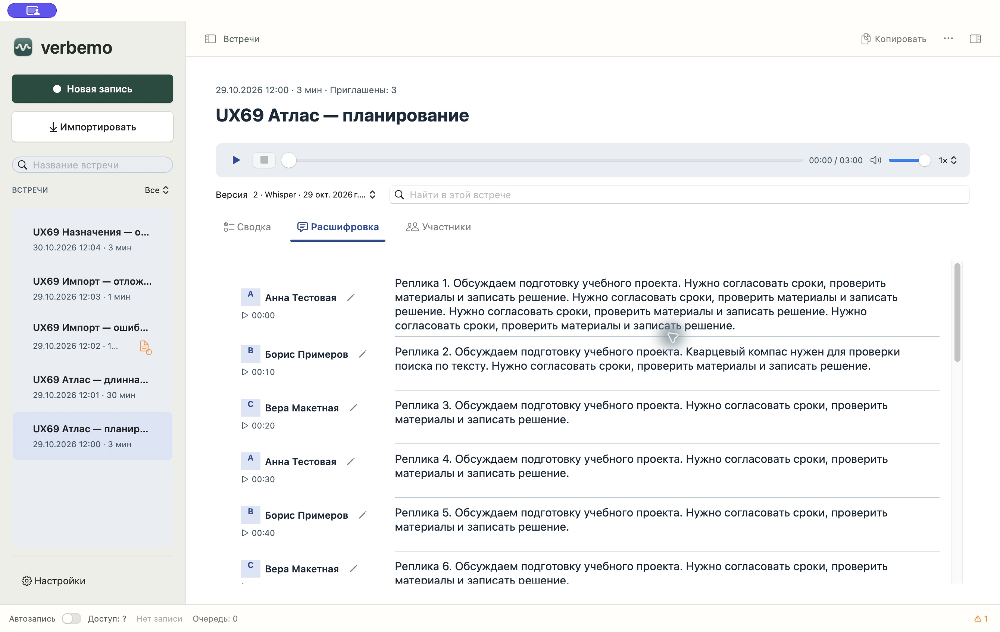

# #72 — нативный Studio-пилот macOS

31.10.2026. Ветка `codex/67-cross-platform-ux-redesign`. Пользовательская приёмка Mac и Windows — отдельные последующие решения; #72 остаётся открытой.

## Сборка и профиль

Текущие исходники: `37566c5`, QA **0.17.2 build 640**, x86_64 + arm64, ad-hoc. Полный прогон на этих исходниках: **1342 tests / 182 suites passed**, 260.945 s, `/tmp/verbemo-ux72-collapse-full.log`; 23 opt-in теста и 6 suites пропущены и не засчитаны проверенными. `make app SIGN_ID=-`, codesign и minimum-target validation прошли. Хост macOS 26.7.1, Xcode 27.1 / SDK 27.0. Минимум 14.2 сохранён; запуск на 14.2 не проверен.

Предыдущая контрольная точка: `eef804e`, build 638. Исторические полный прогон 1338/182 и целевые 66/7 сохранены в [verification.json](verification.json). После пересмотра сворачивания выполнены новый RED→GREEN, полный прогон и GUI-повтор в build 640.

Тестовая копия `.build/ux72/Verbemo Studio QA.app`, bundle ID `name.ekho.verbemo.ux72`; отдельный `.build/ux72/home` через `CFFIXED_USER_HOME`, без изменения HOME. Личная установленная Verbemo не заменялась. Только заново созданный UX69-корпус из пяти вымышленных встреч. Исходный manifest: [qa-before.json](qa-before.json), 28 файлов. У короткой встречи первые три секунды — синтетический 440 Hz тон на малой амплитуде, далее тишина; частной речи нет.

Calendar, ASR, live transcription, speaker naming, summary automation, auto-record и MCP выключены. Для ручной проверки обработки в QA config использовался исключительно localhost `127.0.0.1:18969`, модель `ux69-synthetic`; сервер — существующий mock-summary.py. Это проверка UI lifecycle, не реальной модели.

## Реализация

SwiftUI компонует версии, поиск и вкладки; стабильные native AppKit controls сохраняют редактирование и команды. Контроллер владеет выбранной встречей/версией и поиском. Расшифровка остаётся переиспользуемой NSTableView, аудио — прежним AVPlayer. Форматы хранения, ASR, диаризация и релизный маршрут не менялись.

Исправления, воспроизведённые тестами: no-op Apply сохраняет ручной alias, новая генерация JSON сбрасывает старый поисковый контекст, Cmd-F открывает документ из Details, фоновое обновление сохраняет выделение и незавершённый ввод, Enter/Escape завершают весь popover. Изменённая строка перепроверяет текущую встречу, версию, transcript bytes и доступность записи.

## Проверка интерфейса

Промежуточная GUI-проверка build 631: чтение 18/180 реплик; copy/paste целой русской реплики; поиск «кварцевый компас», «Сапфировый маяк», отсутствующий запрос; Enter/Escape; Play/Pause/seek/конец/Stop, скорость 1.5× и громкость 0.4; переход по времени 29:50; mouse resize библиотеки 248→324.5 и Right→340.5; hide/show сохраняет 340.5. Отмена pencil draft вернула фокус и сохранила все 28 SHA. Ручное имя «Вера QA» обновило шесть реплик C; изменились только speakers.json и transcript.md, включая строку карты говорящих. Аудио, transcript.json и архив остались побайтно прежними.

Эта проверка обнаружила исправленные далее дефекты: ⌘F с русской раскладкой/боковой панелью, перенос SwiftUI header, позиция при resize, фокус после Save и Enter в раскрытом NSComboBox. Финальные повторные шаги и ревизия каждого сохранённого снимка указаны ниже.

## Ограничения

Windows ожидает пользовательской приёмки Mac. VoiceOver, повышенный контраст, Reduce Motion, системный масштаб текста 150/200%, runtime на минимальной macOS и физическая слышимость тона не подтверждены. Unit-тесты и движение player clock сами по себе не подтверждают слышимый вывод. Человеческий baseline скорости работы не собирался.

## Матрица P01–P09

| Проверка | Фактическое свидетельство | Остаток |
|---|---|---|
| P01 | 18/180 реплик, архив, hide/show и ширина библиотеки; реальные GUI builds 631/634 | Settings/back проверен в 635; основной вид и возврат списка повторены в 638. P3 устранён и повторно проверен в 640, см. ниже |
| P02 | RU copy/paste, scroll до 29:50; native tests сохраняют выделение и сегмент в обе стороны resize | EN/emoji проверены matcher/native tests; отдельного GUI copy emoji нет |
| P03 | Cancel без записи, ручное имя, календарный C→Вера, архив, настоящая filesystem-ошибка и успешный retry | 636: фокус вернулся к новому pencil после Apply; outside click сохранил поиск. Busy-state обновление подтверждено controller tests |
| P04 | Реальный AVPlayer: clock, Pause, seek, конец, Stop; speed 1.5×/volume 0.4 сохранены. Unit: смешанные источники и offsets | Физическая слышимость не проверена |
| P05 | Реальные transcript/summary matches, другой регистр, 0/0, Enter/Escape; общие UTF-16 ranges и wrap в тестах | Нет человеческого speed baseline |
| P06 | Выбрана/изменена архивная версия; stale generation/context и чтение с ошибкой покрыты tests | Быстрые серии переключений не измерялись |
| P07 | RU/light и EN/dark на отдельном профиле; перенос header; GUI ширина около 760 pt. Темы/язык проверены перезапуском после правки только QA config | System text 150/200%, minimum-OS runtime не проверены |
| P08 | ⌘F включая Details, Enter/Escape, mouse/arrow divider; программные native focus checks | VoiceOver, полный keyboard-only, contrast/Reduce Motion не проверены |
| P09 | 28 SHA после чтения/поиска/плеера одинаковы; разрешённые производные артефакты после назначения перечислены; реальный localhost POST/active job/error сохранены | 635 GUI: localhost job Active:1 → «Отменить обработку» → Queue:0 / «Готовые результаты сохранены»; исходные материалы прежние |

Это матрица доступной проверки пилота, а не утверждение полного выполнения всех платформенных критериев. #72 остаётся открытой.

## Файлы и обработка

После назначения короткой/архивной версии изменились ровно четыре пути в короткой встрече: `speakers.json`, `transcript.md` и такие же два артефакта в `transcripts/synthetic-previous/`. У архива `speakers.json` появился впервые. Затем на длинной встрече имя A «Анна QA» (в 636 уточнено до «Анна QA 2») обновило 20 реплик; там изменились ещё два производных артефакта (`speakers.json`, `transcript.md`). Текущий C сопоставлен с `ux69-2`; ручной alias «Вера QA» сохранён. Архивный A получил «Архив QA». Аудио, все transcript.json, исходные метаданные, остальные встречи и версии совпадают с [qa-before.json](qa-before.json). Снимок после назначений: [qa-after-assignment.json](qa-after-assignment.json).

Контролируемая summary-ошибка (timeout hold-имитатора→HTTP 500) добавила только `transcribe.log` и изменила `meta.json` короткой встречи. Готовые summary.md, speaker files, transcript JSON и аудио не изменились. [Снимок](qa-after-processing.json). Во время job переход к другой встрече сохранял Active:1; source-файлы не передавались внешнему провайдеру, endpoint в sheet сверен как 127.0.0.1:18969. Это не inference acceptance.

## Живой повтор 635 и итоговое исправление фокуса

Settings → выбор той же длинной встречи вернул текущую версию и Transcript. Имя A на 180 репликах обновило 20 строк. Второй localhost POST в hold-имитатор реально работал; отмена через Details завершила задание и сохранила готовую сводку. Сервер остановлен. В окончательном QA-профиле summary automation выключена и тестовый endpoint удалён.

Возврат фокуса после сохранения требовал исправления именно в controller read-back: повторная загрузка отложена, а не синхронна с Apply. Новый интеграционный тест воспроизвёл потерю фокуса. Контроллер возвращает его после showDetail на актуальный pencil/редактор при той же вкладке, уважая фокус другого поля. Transient close кликом в поиск не запрашивает возврата. 66/7 focused GREEN; окончательный GUI-повтор ниже.

## GUI-повторы и устранение замечания

Build 636: после Apply «Анна QA 2» фокус перешёл на новый карандаш этой же реплики. Popover → клик в поиск → ввод «проверка фокуса» сохранил фокус поиска. На 180 репликах достигнут конец 29:50; resize с широкой колонки до окна около 760 pt сохранил сегмент 175. Эти действия не меняли исходное аудио/JSON/сводки.

Build 638 (`eef804e`): основной экран, реальный match 1/1, Participants с тремя образцами на каждого говорящего, hide/show и достижимость действий повторены. QA оставлена открытой на текущей короткой встрече, Transcript, без query, записи и задания. [Итоговое AX-состояние](final-window.txt).

**P3-MAC-COLLAPSE-LINE устранён в build 640 (`37566c5`).** В 638 после скрытия библиотеки оставалась линия на старой границе — [исторический снимок](10-hidden-library.jpg). Три локальные попытки были остановлены; 31.10 пользователь разрешил пересмотреть механизм.

Минимальный AppKit-пример воспроизвёл отдельный слой разделителя на x248 после ручного `isHidden`/`adjustSubviews`; прозрачное содержимое пропускало линию, непрозрачное маскировало её. Удаление одного resize override также не решало проблему. `NSSplitViewController` с `NSSplitViewItem.isCollapsed` согласованно скрывает колонку и разделитель. Оболочка переведена на него; удалены собственные frame/draw patches и отдельное хранение ширины. Небольшой subclass оставлен только для клавиатуры. Сворачивание управляется кнопкой, перетаскивание меняет ширину в границах; ширину и восстановление хранит системный контроллер.

Регрессия `collapsedLibraryHasNoVisibleDividerOverContent` дождалась цикла AppKit и поймала видимый вертикальный слой на прежнем коде (RED, `/tmp/verbemo-ux72-collapse-red.log`); затем прошла с новым контроллером. Целевые **28 tests / 3 suites passed**, `/tmp/verbemo-ux72-collapse-green.log`; затем полный **1342/182 GREEN**. Независимое read-only ревью трёх изменённых файлов замечаний не выявило; GUI оно не заменяло.

GUI640: мышь 248→324.5 pt, Right→340.5; hide/show и узкое окно 761×600 pt; возврат списка ограничил ширину до 340 pt для сохранения не менее 420 pt содержимому. Линии нет в широком и узком окне. ⌘F, ввод «кварцевый компас», Escape и возврат списка сохранили текущую встречу/версию/вкладку. [Исправленное узкое окно](11-hidden-library-fixed.jpg), [восстановленный основной вид](12-restored-library.jpg). После всех действий **все 30 файлов корпуса совпадают** с предыдущим qa-after.json; новых записей в встречи нет.

QA640 оставлена открытой: текущая короткая встреча, Transcript, список 248 pt, поиск пуст, плеер остановлен, Queue:0. [Итоговое AX-состояние](final-window.txt). P3 закрыт как дефект; пользовательская приёмка Mac ещё не получена. Windows и перечисленные выше недоступные проверки не засчитаны.

| Снимок | Build | Содержание |
|---|---:|---|
| [01](01-transcript-light.jpg) | 638 | Текущая короткая встреча, основной вид |
| [02](02-search.jpg) | 638 | Подсветка и счётчик реального поиска |
| [03](03-no-results.jpg) | 634 | EN/dark, отсутствующий запрос |
| [04](04-long-end.jpg) | 636 | Реплика 180, 29:50 |
| [05](05-narrow-dark-en.jpg) | 634 | EN/dark, перенос шапки и match |
| [06](06-participants.jpg) | 638 | Прямой выбор, три образца, C→Вера |
| [07](07-save-error.jpg) | 634 | Настоящая ошибка filesystem, сохранённый draft |
| [08](08-cancelled-processing.jpg) | 635 | Отмена localhost job, старые результаты сохранены |
| [09](09-narrow-light.jpg) | 636 | RU/light на минимальной ширине |
| [10](10-hidden-library.jpg) | 638 | Историческое воспроизведение P3 |
| [11](11-hidden-library-fixed.jpg) | 640 | Скрытая библиотека без линии, 761×600 pt |
| [12](12-restored-library.jpg) | 640 | Основной вид после восстановления списка |

